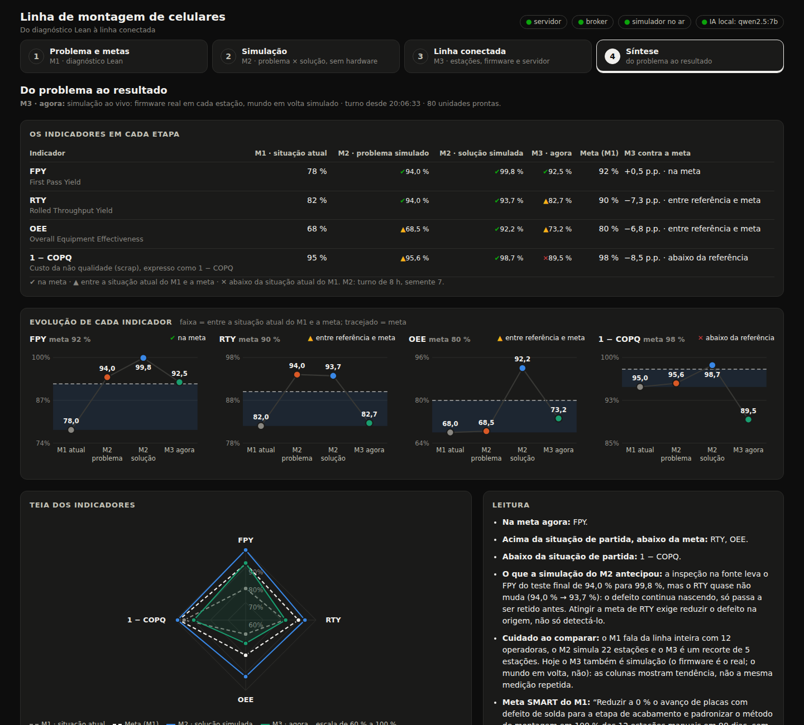
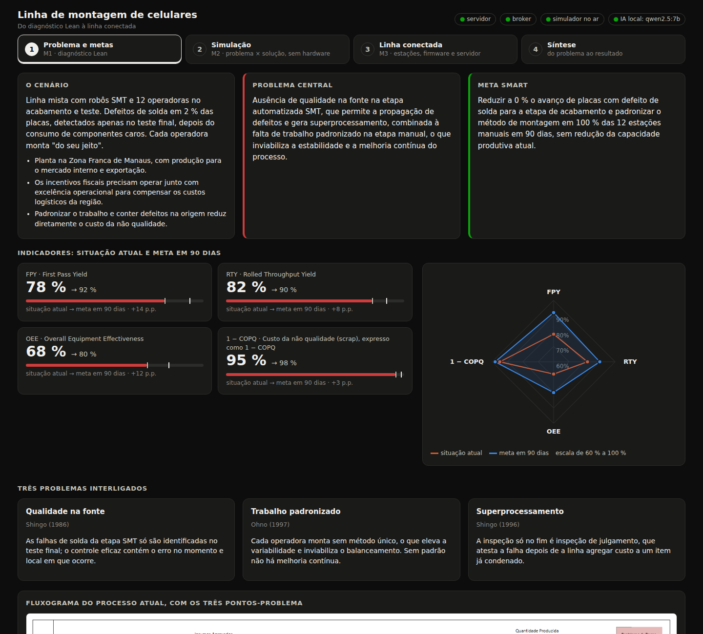
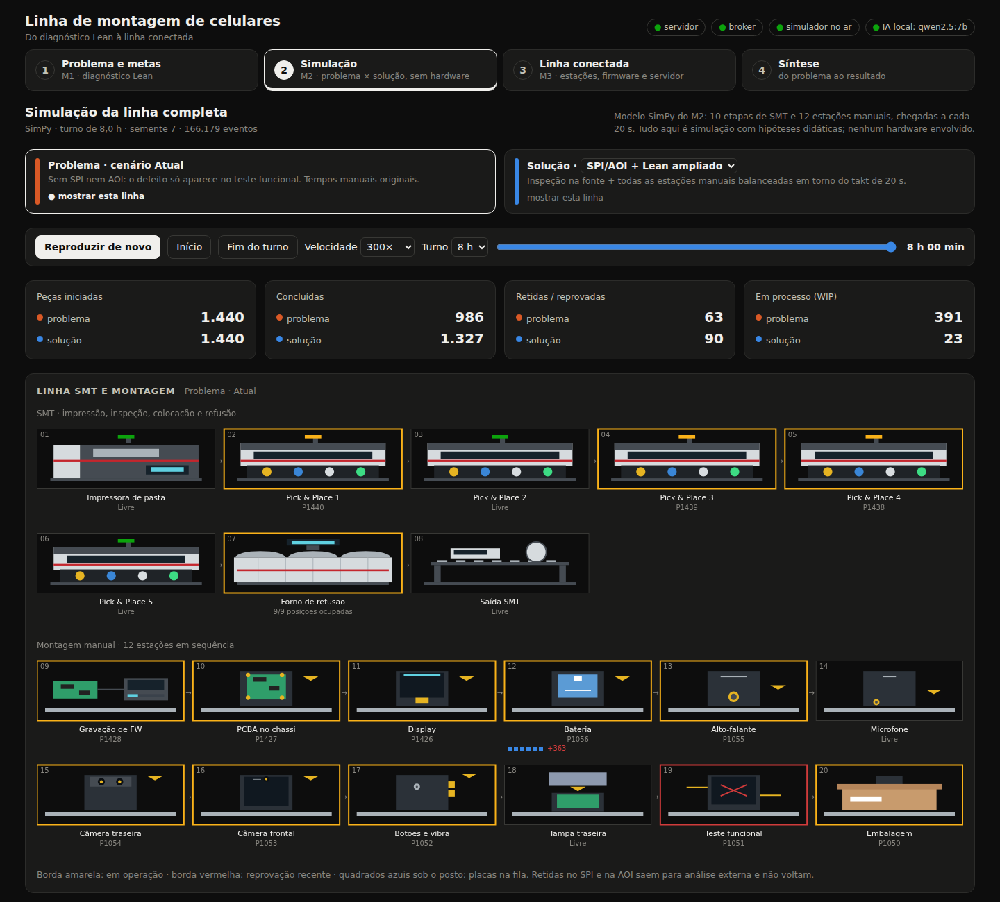
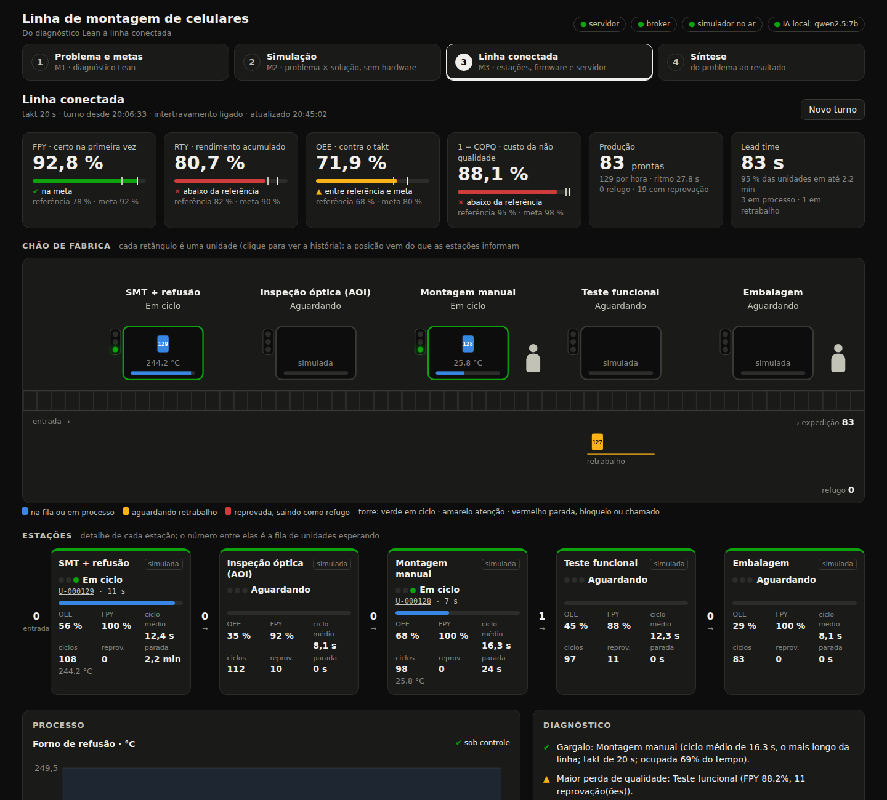
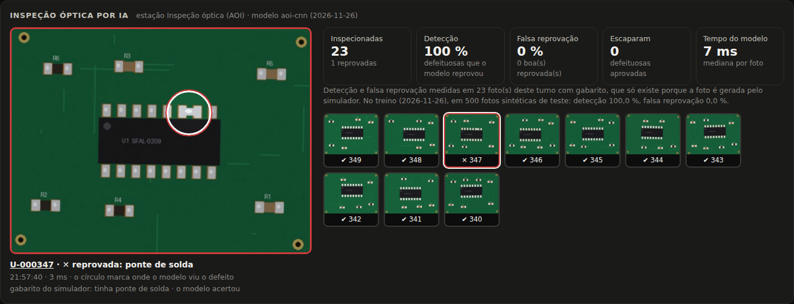

# Smart Factory Assembly Line

Sistema de acompanhamento e controle de uma linha de montagem de celulares, do botão na bancada ao painel:
cada estação é uma placa ESP32 que cronometra o ciclo, registra aprovado/reprovado, aciona a torre luminosa e só
deixa a unidade avançar se o servidor liberar. O servidor guarda a história de cada unidade, calcula FPY, RTY, OEE e
lead time em tempo real, vigia o processo (CEP) e segura a estação quando ele sai de controle.

O **simulador executa o mesmo firmware** que vai para a placa: o núcleo em C++ é compilado para o ESP32 e, sem
mudar uma linha, como biblioteca carregada pelo simulador. O que é simulado é só o mundo em volta (unidades,
operador, forno, defeitos). Dá para validar a ideia sem hardware, trocar uma estação por uma placa real, ou as cinco.

O painel conta a história em quatro abas:

| Aba | O que mostra |
|---|---|
| **1 · Problema e metas** | O diagnóstico Lean do M1: cenário, problema central, meta SMART, indicadores atuais e metas, os oito desperdícios, Ishikawa com os 5 Porquês, Pareto, plano de ação e os fluxogramas atual e futuro |
| **2 · Simulação** | O modelo SimPy do M2 (10 etapas de SMT + 12 estações manuais), sem hardware: a linha desenhada, reprodução do turno e os indicadores do **problema** e da **solução** lado a lado |
| **3 · Linha conectada** | O M3: estações com firmware, chão de fábrica animado, indicadores ao vivo, carta de controle, rastreabilidade, assistente de IA, "E se?" e falhas provocadas |
| **4 · Síntese** | Cada indicador do M1 ao M3 contra a meta, teia, Pareto por etapa, Ishikawa com o que foi feito de cada causa-raiz, lead time, WIP e vazão |



| | |
|---|---|
|  |  |
|  | |

## Rodar

Pré-requisito: Docker com Compose.

```bash
./start.sh simulation        # tudo simulado: broker + servidor + simulador
./start.sh prod              # espera hardware real: broker + servidor, sem simulador; mostra o IP para as placas
./start.sh simulation --ia   # qualquer modo com --ia: sobe também a IA local do Assistente (Ollama)
./start.sh simulation --sem-aas   # sem os servidores AAS (BaSyx e FA³ST)
./stop.sh                    # derruba e apaga os dados da linha (pede confirmação; --sim não pergunta)
./stop.sh --tudo             # apaga também os modelos do Ollama e a imagem construída
```

Painel em http://localhost:8000 · catálogo de produtos (BaSyx) em http://localhost:3000 · estações por OPC UA em
`opc.tcp://localhost:4840` (precisa do jar do FA³ST em `tools/`; ver [docs/AAS.md](docs/AAS.md)). Para trocar de modo, rode `./stop.sh` antes: o `start.sh` se recusa a misturar dados
de simulação com os da linha real. O `stop.sh` sem `--tudo` mantém os modelos do Ollama (~11 GB), que não guardam
estado da linha e demoram a baixar. Por baixo é `docker compose`, que continua funcionando direto.

Na aba **Linha conectada**:

- **Indicadores** (FPY, RTY, OEE, 1 − COPQ) contra a referência e a meta definidas em `config/line.yaml`.
- **Chão de fábrica**: a linha desenhada e animada — unidades andando pela esteira, fila antes de cada estação,
  prateleira de retrabalho, saída para expedição ou refugo, torre luminosa e posto com operador. A posição de cada
  unidade vem do que as estações informam, então a vista serve igual para placas reais.
- **Estações**: estado, unidade em processo, fila e indicadores de cada uma.
- **Inspeção óptica por IA**: a última foto inspecionada com o veredito e o local do defeito, as fotos recentes e o
  desempenho do modelo no turno (detecção, falsa reprovação, placas que escaparam).
- **Processo**: carta de controle do forno e tempos de ciclo recentes.
- **Rastreabilidade**: toda a história de uma unidade (estações, tentativas, esperas, temperatura).
- **Assistente**: perguntas em português sobre a linha e relatório do turno, respondidos pela IA local a partir
  dos dados do momento. Sem a IA, responde o diagnóstico por regras.
- **E se?**: compara cenários rodando um turno de 8 h em poucos segundos.
- **Provocar falhas** (só com o simulador): deriva do forno, queda de rede, quebra, operador lento, surto de defeitos.

### De onde vem cada número

- **M1** (`config/m1.yaml`): transcrição da entrega do Módulo 1. São estimativas do grupo para o cenário.
- **M2** (`software/sfal/m2`): o modelo SimPy da entrega do Módulo 2, portado sem mudar as hipóteses. Um teste
  confere que ele reproduz os resultados publicados no M2 (por exemplo, cenário Atual em 8 h: 986 concluídas, 63
  reprovadas no teste, WIP de 391, lead time de 69,43 min, OEE de 68,47 %).
- **M3**: o que as estações informam agora. Com as estações simuladas, a aba Síntese rotula a coluna como
  "simulação ao vivo"; com placas ESP32, como "medido".
- As três etapas representam linhas de tamanhos diferentes (linha inteira, 22 estações, recorte de 5). A Síntese
  mostra direção, não a mesma medição repetida, e diz isso na tela.

## O que o sistema faz

| Função | Como |
|---|---|
| Inspeção óptica por IA | Na AOI, um classificador de visão analisa a foto de cada placa (ponte de solda, solda ausente, excesso), aponta onde está o defeito e o resultado encerra o ciclo da estação |
| Gêmeos digitais (AAS) | Produtos e unidades no BaSyx por HTTP, desde o planejamento, com a situação de fabricação; estações no FA³ST por OPC UA, com a máquina de estados ([docs/AAS.md](docs/AAS.md)) |
| Pedidos | A unidade nasce planejada, com número de série, antes de ser fabricada |
| Qualidade na fonte | A estação pede liberação ao ler a unidade. Reprovada antes, pulou etapa, já processada ou refugada: bloqueia (vermelho + buzina) |
| Retrabalho e refugo | Reprovada volta à mesma estação; na 3ª reprovação (ou em estação `on_fail: scrap`) vira refugo |
| Jidoka | Ponto do forno além de 3σ retém a estação até o processo voltar ao controle |
| Andon | Botão de chamado para a estação, pisca vermelho, conta como parada no OEE |
| Rede instável | Sem servidor, a estação segue em modo degradado; sem rede, guarda até 24 eventos e envia na volta com a idade de cada um |
| Estação sem leitor | Só botões: o servidor atribui a unidade mais antiga da fila (FIFO) |
| Indicadores | FPY, RTY, OEE (disponibilidade × desempenho × qualidade), lead time, WIP, gargalo; definições em `software/sfal/kpi.py` |

## Onde entra a IA

| Uso | O que é | Papel |
|---|---|---|
| **Inspeção óptica (AOI)** | Rede convolucional pequena treinada para a tarefa (`models/aoi.onnx`, `tools/train_aoi.py`), rodando no servidor | **Decide**: aprova ou reprova cada placa |
| Assistente | Modelo de linguagem no Ollama | Só lê os dados e escreve texto; não decide nada |



A inspeção usa um classificador treinado, e não o Ollama, por medição: em 2026-11-26, em 40 fotos com gabarito, os
modelos de visão genéricos do Ollama não serviram — `qwen2.5vl:7b` detectou 35 % dos defeitos e `gemma3:4b` reprovou
todas as placas, boas inclusive. Para repetir a medição ou experimentar outro modelo: `vision.engine: ollama` em
`config/line.yaml`.

**As fotos são sintéticas.** Não há câmera: o simulador gera a foto de cada placa (`software/sfal/vision/board.py`) e o
classificador foi treinado e medido nesse mesmo tipo de imagem. Isso valida o caminho foto → veredito → estação →
rastreabilidade, não a detecção em placas reais. Com uma câmera, é preciso fotografar placas boas e defeituosas e
retreinar; o caminho de envio da foto (`POST /api/vision/inspect`) é o mesmo.

## Placas reais

`docs/HARDWARE.md` tem lista de materiais, ligações e gravação. Em resumo:

```bash
cd firmware
cp include/secrets.h.example include/secrets.h     # Wi-Fi e IP do computador do broker
pio run -e esp32-asm -t upload                      # grava a estação "asm"
```

Modo híbrido (uma placa real, o resto simulado): `SFAL_REAL=asm docker compose up -d`.
Só placas reais: `docker compose up -d broker backend`.

## E se?

```bash
cd software && uv run sfal whatif --hours 8
```

```
cenário       FPY    RTY    OEE  prontas  refugo   WIP  lead time  gargalo
padrao      85.4%  85.4%  98.8%     1423       4     5    1.6 min      asm
atual       79.0%  79.0%  76.2%     1097       9   333   56.7 min      asm
futuro      93.3%  93.2%  99.3%     1430       1     3    1.2 min      asm
```

Saída de 2026-11-26, semente 42. São **resultados de simulação**: os parâmetros de cada cenário (taxa de defeito,
variação do operador, quebras) são hipóteses escritas em `config/line.yaml`, não medições de uma fábrica.

## Desenvolvimento

```bash
cd software && uv sync && uv run pytest            # servidor, indicadores, CEP, simulador (48 testes)
cd firmware && pio test -e native                  # núcleo do firmware no PC (13 testes)
cd firmware && pio run -e esp32-asm                # compila para a placa
uv run --project software python tools/golden.py   # traço de referência firmware × simulador
```

Sem Docker: um broker MQTT em `localhost:1883`, depois `uv run sfal server` e `uv run sfal sim` em `software/`.

## Estrutura

| Pasta | Conteúdo |
|---|---|
| `config/line.yaml` | A linha: estações, rota, takt, regras, metas, cenários |
| `firmware/lib/station_core` | Núcleo da estação (C++ puro): o mesmo código no ESP32 e no simulador |
| `firmware/src` | Camada do ESP32: pinos, Wi-Fi, MQTT |
| `firmware/sim` | Ponte C que expõe o núcleo ao simulador |
| `config/m1.yaml` | O diagnóstico do M1 e o que foi feito de cada causa-raiz |
| `software/sfal` | Servidor (`engine`, `kpi`, `spc`, `assistant`, `api`), simulação do M2 (`m2`), síntese (`sintese`), painel (`web`) e simulador do M3 (`sim`) |
| `models`, `tools/train_aoi.py` | Classificador da inspeção óptica (ONNX) e o script que o treina |
| `docs` | [Arquitetura](docs/ARCHITECTURE.md), [protocolo MQTT](docs/PROTOCOL.md), [hardware](docs/HARDWARE.md), [AAS](docs/AAS.md), [decisões](docs/adr/README.md) |

## Limitações conhecidas

- **Nenhuma placa física foi testada.** O firmware compila para ESP32 e o núcleo passa nos testes no PC e roda no
  simulador, mas pinos, Wi-Fi, leitor e sensores reais não foram exercitados. O primeiro teste em bancada pode
  revelar ajustes na camada `firmware/src`.
- **A inspeção óptica nunca viu uma placa de verdade.** Treino e teste são com fotos sintéticas; o desempenho medido
  não se transfere para uma câmera real sem novo conjunto de fotos e novo treino. O "E se?" continua usando as
  probabilidades `detect_p`/`false_fail_p` da AOI, que devem ser atualizadas com o desempenho medido do modelo.
- **Os cenários do "E se?" não foram calibrados com dados reais.** Para confiar nos números, meça tempos de ciclo e
  taxas de defeito na linha e ajuste os blocos `sim` do `config/line.yaml`.
- **Broker sem autenticação** por padrão: use só em rede isolada ou configure senha (`docs/HARDWARE.md`).
- **O assistente erra.** O modelo de 7 B às vezes interpreta mal um número; os valores do painel são a referência.
- **Uma linha, um servidor.** Não há usuários, turnos cadastrados nem integração com ERP.
